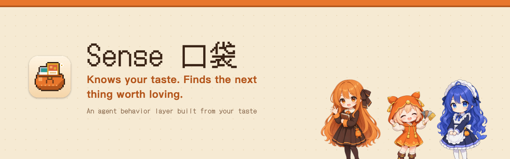

<b>Your personal taste agent.</b> An agent behavior layer built from your taste. <a href="README.md">中文</a> · English · <a href="README.ja.md">日本語</a>

<a href="https://ludics.space"><b>Website · Download</b></a> · <a href="https://ludics.space/demo/">Live demo</a> · <a href="docs/SENSE.md">Design doc (Chinese)</a>

**Sense is an agent behavior layer**: it abstracts your everyday behavior, interests and preferences into *taste*, then fixes that taste into a set of agent behaviors that run on their own.

## How it works

| | Step | What it means |
|---|---|---|
| 1 | **Watch what you do** | Screenshots, what you watch and listen to, what you save, judgments you told your AI — all of it is behavior. Read only on your Mac. |
| 2 | **Abstract it into taste** | Behavior is distilled into individual tastes, each traceable to its evidence (which file, which session, which page). In the pocket, one taste is one card. No scores, no percentages. |
| 3 | **Fix taste into behavior** | A taste can become an **action** (do something for you), a **follow** (check how it changes, on a schedule) or **news** (tell you when something new turns up). |
| 4 | **You tune the rules** | Stone → bronze → silver → gold: a stone card ignored for 7 days shatters, keep it and it's bronze, follow it and it's silver, two silvers sharing one reason fuse into gold. Every click decides whether these behaviors run and how often. |
| 5 | **Show your sense** | The Sense page lays out your current taste as a showcase card you can save and share. |

## What it looks like

| Starting point | The behavior Sense fixes in place |
|---|---|
| **A person**: you want to cold-email a friend | Drafts the email, then keeps following how they change and where your relationship stands |
| **A goal** | Checks your habits on a schedule: are you moving toward it? |
| **An interest**: an idol, a film | Keeps watching for its news and what's next |

Today it's a macOS desktop app. Later it can be a phone, or grow a whole set of new behaviors: you customize your own habit behaviors, as a game (levels, commissions, building your agents like a deck). That part is planned.

Cross-domain guesses (e.g. from the music you play to the anime you watch) are only ever asked as questions; they count once you confirm.

## Desk companions

The pocket stands on your desktop and only acts out what really happens: it munches when a card comes in, flinches when one shatters, works while the engine searches, naps when you pause it. Who stands there, female or male version, is your pick in the quick menu.

<table>
<tr>
<td align="center"> <b>Pouchling</b> the little one · the pocket itself</td>
<td align="center"> <b>Claude</b> young lady / young master · Claude engine</td>
<td align="center"> <b>DeepSeek</b> chubby whale · DeepSeek engine</td>
</tr>
</table>

> Character pets, the DeepSeek engine, voice calls and card lineage are in the source and ship with the next release; today's 0.1.0 has the pixel-pouch pet. Voice calls are experimental; the local voice service they need will be open-sourced later.

## Download and run

- **Installer**: the `.dmg` in [GitHub Releases](https://github.com/nikoloside/sense/releases/latest). macOS on Apple silicon only. Not notarized; if the first launch is blocked, use System Settings › Privacy & Security › "Open Anyway".
- **Requires** [Claude Code](https://claude.com/claude-code), installed and signed in. Every agent call is a local `claude -p` on your own account. To use DeepSeek as the engine, put your own `deepseek_api_key` in `~/Library/Application Support/Sense/config.json`. Reading YouTube Music / Spotify pages needs the Claude in Chrome extension.
- **Permissions**: Screen Recording for screenshots (⌃⇧⌘A, rebindable); Full Disk Access to read Chrome history (optional).
- **Build from source**: see [app/README.md](app/README.md). Pass a signing identity with `APPLE_SIGNING_IDENTITY`; it never goes into the repo.

## Where the data comes from, and where it stays

- ⌃⇧⌘A screenshots (also copied to the clipboard), opt-in pickup of screenshots on the clipboard, opt-in clipboard capture, images dropped onto the desktop pet.
- Your own Chrome history and YouTube watch history, read locally from a temporary copy that is deleted right after. Other people's Chrome profiles are listed under `exclude_profiles` in the local `config.json` and never opened.
- Your signed-in YouTube Music / Spotify pages, read through Claude in Chrome with read-only tools and a fixed allowlist; only titles and artists are kept.
- Judgments you stated in your Claude Code sessions.

Raw logs never leave your Mac; redaction happens at the read boundary.

## Docs

Design docs and the decision log are in Chinese: [docs/SENSE.md](docs/SENSE.md) (the single source of truth), [docs/decisions/](docs/decisions/), [docs/framework.html](docs/framework.html). Characters: [docs/art/characters.md](docs/art/characters.md), [characters/](characters/). Website and teaser: [site/](site/), [video/](video/) (Remotion).

## About the data in this repo

`m0/pocket.json` and the demo are the author's real pocket, published as-is with the author's consent; third-party names were removed. Once installed, your pocket grows from your own data under `~/Library/Application Support/Sense/` and is never uploaded.

MIT License · by [nikoloside](https://github.com/nikoloside)
