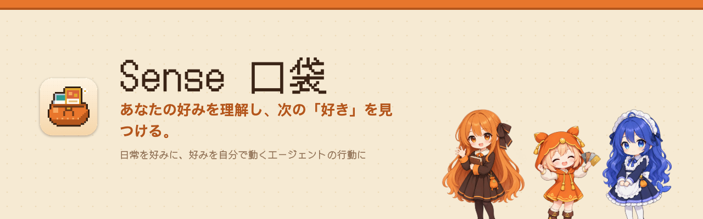

<b>Your personal taste agent.</b> An agent behavior layer built from your taste. <a href="README.md">中文</a> · <a href="README.en.md">English</a> · 日本語

<a href="https://ludics.space"><b>公式サイト · ダウンロード</b></a> · <a href="https://ludics.space/demo/">オンラインデモ</a> · <a href="docs/SENSE.md">定義文書（中国語）</a>

**Sense はエージェントの行動レイヤーです**。日々の行動・興味・好みを「好み（テイスト）」として抽象化し、それを自分で動くエージェントの行動として固定します。

## しくみ

| | ステップ | 内容 |
|---|---|---|
| 1 | **行動を見る** | スクショ、見たもの・聴いたもの、保存したもの、AI に話した判断。すべて行動です。読むのはあなたの Mac の中だけ。 |
| 2 | **好みに抽象化する** | 行動を一つひとつの好みにまとめ、どれも根拠（どのファイル、どの会話、どのページ）までたどれます。ポケットでは、好み一つがカード一枚。点数もパーセントもなし。 |
| 3 | **好みを行動として固定する** | 好みは**アクション**（代わりに何かをする）、**フォロー**（定期的に変化を見る）、**お知らせ**（新しいものが出たら伝える）のどれかになります。 |
| 4 | **ルールはあなたが調整** | 石 → 銅 → 銀 → 金：7 日放っておいた石は砕け、残せば銅、フォローすれば銀、同じ「なぜ」を語れる銀 2 枚は融合して金に。クリックのたびに、行動が動くかどうか、どのくらいの頻度かが決まります。 |
| 5 | **あなたの sense を見せる** | Sense ページは今の好みを一枚のショーケースに。画像で保存して共有できます。 |

## 使うとこうなる

| きっかけ | Sense が固定する行動 |
|---|---|
| **ある人**：友だちにコールドメールを送りたい | メールを下書きし、そのあともその人の変化と、二人の関係がどこまで進んだかを追い続ける |
| **ある目標** | 習慣を定期的にチェック。目標に向かっているか |
| **ある趣味**：推しのアイドル、ある映画 | ニュースや新しい動きをずっと見張る |

いまは macOS のデスクトップ版。いずれスマホにも、新しい行動のセットにもなれます。習慣の行動は自分でカスタマイズでき、ゲームとして（レベル、依頼、デッキを組むようにエージェントを組む）。この部分は計画中です。

領域をまたぐ推測（聴いている曲から観ているアニメを推す、など）は質問としてだけ出し、あなたが認めて初めて使います。

## デスクの相棒

ポケットはデスクトップに立ち、本当に起きたことだけを演じます。カードが入ると食べ、砕けるとびくっとし、エンジンが調べている間は働き、止めたらお昼寝。誰が立つか、女の子版か男の子版かはクイックメニューで選べます。

<table>
<tr>
<td align="center"> <b>ポケット精</b> ちびっこ · ポケットそのもの</td>
<td align="center"> <b>Claude</b> お嬢様 / お坊ちゃま · Claude エンジン</td>
<td align="center"> <b>DeepSeek</b> まんまるクジラ · DeepSeek エンジン</td>
</tr>
</table>

> キャラのペット、DeepSeek エンジン、音声通話、カードの系譜はソースにはもう入っていて、次のリリースのインストーラから使えます。いまの 0.1.0 はドット絵のポケットのペットです。音声通話は実験中で、必要なローカル音声サービスは後日オープンソース化します。

## ダウンロードと起動

- **インストーラ**：[GitHub Releases](https://github.com/nikoloside/sense/releases/latest) の `.dmg`。Apple シリコンの macOS のみ。公証を受けていないので、初回起動がブロックされたら システム設定 › プライバシーとセキュリティ ›「このまま開く」。
- **必要なもの**：インストール済みでログインした [Claude Code](https://claude.com/claude-code)。エージェントの呼び出しはすべてローカルの `claude -p` で、あなた自身のアカウントです。DeepSeek をエンジンにするなら `~/Library/Application Support/Sense/config.json` に自分の `deepseek_api_key` を。YouTube Music / Spotify のページを読むには Claude in Chrome 拡張が必要です。
- **権限**：スクショ（⌃⇧⌘A、変更可）には「画面収録」、Chrome 履歴には「フルディスクアクセス」（任意）。
- **ソースからビルド**：[app/README.md](app/README.md) を参照。署名は `APPLE_SIGNING_IDENTITY` で渡し、リポジトリには入れません。

## データの出どころと保存先

- ⌃⇧⌘A のスクショ（クリップボードにもコピー）、オンにしたときだけのクリップボードのスクショ取り込みと記録、デスクトップペットへの画像ドロップ。
- あなた自身の Chrome 履歴と YouTube 視聴履歴。一時コピーをローカルで読み、すぐ削除。他人の Chrome プロフィールはローカルの `config.json` の `exclude_profiles` に書き、開きません。
- ログイン中の YouTube Music / Spotify のページ。Claude in Chrome を読み取り専用ツールと固定の許可リストで使い、曲名とアーティストだけを残します。
- Claude Code との会話であなたが述べた判断。

生のログは Mac の外に出ません。匿名化は読み込みの時点で行います。

## ドキュメント

設計ドキュメントと決定ログは中国語です：[docs/SENSE.md](docs/SENSE.md)（唯一の定義文書）、[docs/decisions/](docs/decisions/)、[docs/framework.html](docs/framework.html)。キャラ：[docs/art/characters.md](docs/art/characters.md)、[characters/](characters/)。公式サイトと紹介動画：[site/](site/)、[video/](video/)（Remotion）。

## このリポジトリのデータについて

`m0/pocket.json` とデモは作者本人の実際のポケットで、作者の同意のもとそのまま公開しています。第三者の名前は削除済みです。インストール後、あなたのポケットはあなた自身のデータから `~/Library/Application Support/Sense/` に育ち、アップロードされません。

MIT License · by [nikoloside](https://github.com/nikoloside)
