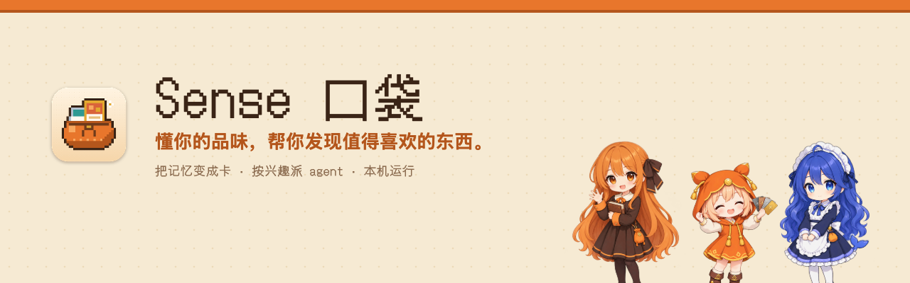

<b>Your personal taste agent.</b> · 中文 · <a href="README.en.md">English</a> · <a href="README.ja.md">日本語</a>

<a href="https://ludics.space"><b>官网 · 下载</b></a> · <a href="https://ludics.space/demo/">在线 Demo</a> · <a href="docs/SENSE.md">定义文档</a>

Sense 是一组替你干活的 agent。它们记得什么、去做什么，都由你口袋里的卡决定：你和 AI 聊过的判断、看过听过截过的东西，被整理成一张张有证据的卡；你留下、丢掉、关注，agent 就照着去查更新、找新东西、回头看进度。

## 核心概念

| | 概念 | 说明 |
|---|---|---|
| 1 | **记忆变成卡** | 判断和素材都整理成卡，每张都能追到证据（哪个文件、哪次会话、哪一页）。卡就是 agent 的记忆：看得见、改得了、带得走。不打分、不算百分比。 |
| 2 | **规则就是品级** | 石 → 铜 → 银 → 金。7 天没理会的石卡会碎；留下变铜，跟了变银，两张银卡说得出同一个为什么就融合成金。你点的每一下都在改 agent 的规则。 |
| 3 | **关注什么，就派什么 agent** | 银卡定期查它自己的新一话、新作、新论文；金卡按这种口味往外找；用例卡按你写的去做一件事（找人、查更新、起草一封信）。 |
| 4 | **定期回头看进度** | 你立下的决定、在做的项目也能放上追踪台：到点了查一次、问一句做到哪了。 |
| 5 | **展示你的 sense** | Sense 页把现在的口味排成一张展示卡，能存成图片分享，带一个指向官网的二维码。 |
| 6 | **自定义 agent，做成游戏**（计划中） | 已经有等级、委托、任务和 XP。接下来让你自己配 agent：卡槽里放什么、多久跑一次、出一手怎么出，像组卡组一样。 |

跨领域的猜测（比如从你听的歌推到你看的番）只会作为问题问你，你确认了才算数。

## 桌上的伙伴

口袋会站在你的桌面上，只演口袋里真发生的事：进卡会吃、碎卡会抖、引擎在查时干活、暂停了就睡。谁站在那儿、女版还是男版，在快捷菜单里自己选。

<table>
<tr>
<td align="center"> <b>口袋精</b> 小可爱 · 口袋本身</td>
<td align="center"> <b>Claude</b> 大小姐 / 大少爷 · 引擎用 Claude 时</td>
<td align="center"> <b>DeepSeek</b> 大肥鱼 · 引擎用 DeepSeek 时</td>
</tr>
</table>

> 角色桌宠、DeepSeek 引擎、语音通话、卡片谱系在源码里已经有了，安装包从下一版开始带上；现在的 0.1.0 是像素口袋桌宠。语音通话还在实验，依赖的本机语音服务之后开源。

## 下载和运行

- **安装包**：[GitHub Releases](https://github.com/nikoloside/sense/releases/latest) 里的 `.dmg`，只支持 macOS（Apple 芯片）。没有经过 Apple 公证，第一次打开被拦时到「系统设置 › 隐私与安全性」点「仍要打开」。
- **需要**：已安装并登录的 [Claude Code](https://claude.com/claude-code)。所有 agent 调用都是本机的 `claude -p`，用你自己的账号。想用 DeepSeek 当引擎，在 `~/Library/Application Support/Sense/config.json` 里填自己的 `deepseek_api_key`。读听歌页面要 Claude in Chrome 扩展。
- **权限**：截图（⌃⇧⌘A，可改）要「屏幕与系统录音」；读 Chrome 履历要「完全磁盘访问权限」（可选）。
- **自己编译**：见 [app/README.md](app/README.md)。签名证书用环境变量 `APPLE_SIGNING_IDENTITY` 传入，不写进仓库。

## 数据从哪来，留在哪

- ⌃⇧⌘A 截图（同时放进剪贴板）、可选的收剪贴板截图、可选的剪贴板记录、拖给桌宠的图片。
- 你自己的 Chrome 履历和 YouTube 观看记录：本机读临时副本，读完即删。别人的 Chrome profile 写在本机 `config.json` 的 `exclude_profiles` 里，从不打开。
- 你登录着的 YouTube Music / Spotify 页面：Claude in Chrome 只用只读工具读白名单里的几页，只留歌名和歌手。
- 你在 Claude Code 会话里说过的判断。

原始日志不出你的 Mac，脱敏在读取边界完成。

## 文档

| 文件 | 内容 |
|---|---|
| [docs/SENSE.md](docs/SENSE.md) | **唯一的定义文档**：论点、核心闭环、形态、数据模型、引擎规则、隐私、范围、里程碑、术语表 |
| [docs/decisions/](docs/decisions/) | 决策日志，每条一个文件 |
| [docs/framework.html](docs/framework.html) | 系统框架图解 |
| [docs/art/characters.md](docs/art/characters.md) | 角色设定与出图需求 |
| [characters/](characters/) | 每个角色的 soul.md（性格、说话方式、边界）和中日英音色 |
| [app/](app/) · [m0/](m0/) | 桌面版（Tauri）与口袋页面 |
| [site/](site/) · [video/](video/) | 官网与介绍动画（Remotion） |
| [BACKLOG.md](BACKLOG.md) | 任务清单 |

## 关于仓库里的数据

`m0/pocket.json`（以及 demo）是作者本人的真实口袋，作者同意原样公开，第三方的名字已经去掉。你装上之后，口袋从你自己的数据重新长出来，存在 `~/Library/Application Support/Sense/`，不上传。

MIT License · by [nikoloside](https://github.com/nikoloside)
