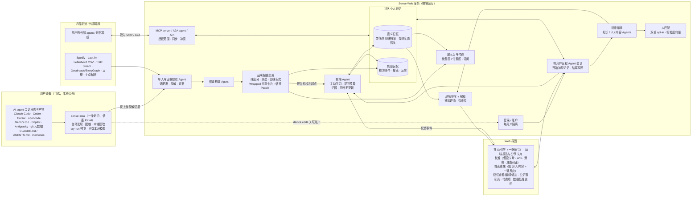

> **已归档（2026-10-20）**：这是 v0.5 完整设计稿，当前定位见 product-brief.md，第一版范围见 v1-scope.md。此稿中被 v1 排除的功能保留作后续素材，不是待办。

# Sense：人在回路（HITL）的个人品味校准 Agent

### 一个按需运行、带持久个人记忆的 Web 服务：读取你的 AI agent 与内容足迹，和你一起校准品味，再用你的品味去搜索知识、人和内容

*设计文档 v0.5 · 给 Niko Los 的草案 · 2026-10-19 (JST)*
*标注 **[待核实]** 的内容是对第三方产品、格式或 API 的假设，开发前需要确认。*
*标注 **〔借鉴 Paxel〕** 的部分参考了 YC 的 Paxel（见文末「竞品：Paxel」）；没有标注的是 Sense 自己的设计。*

---

## 0. 一段话概述

Sense 是一个 **Web 服务**。用户登录后，会得到一个**属于自己的服务端远程 agent**，背后是一套**持久的个人记忆系统**。

agent 首先从两类数据里得出初版"品味档案"：
- **主数据源（核心差异点）**：用户的 **AI / coding agent 系统**，包括 Claude Code、Codex 的 memory、指令文件、会话历史和项目。
- **内容足迹**：歌单与听歌记录、电影、游戏、书籍。

然后它**与用户持续校准**这份档案，方式包括假设卡片、A/B 对比、"类型对但情绪不对"这类反馈，以及纠正推荐理由。最后它**用用户自己的品味主动去搜索**知识、人和内容，这就是**反向推荐**：驱动搜索的是用户的品味，不是平台算法。

用户还可以生成一个**公开品味展示页**，分免费区和付费区，可以借此变现。

**上手方式 〔借鉴 Paxel〕**：
1. 用户复制一条命令，运行本地连接器 `sense-local`。
2. 连接器自动找到本机的 agent 会话日志，在本机完成提取，**只上传脱敏后的品味证据**，然后关联到 Web 账户。
3. 几分钟后，用户拿到第一份**品味报告**：维度分、原型标签，以及可以分享的 Wrapped 风格品味卡片。

和 Paxel 不同的是，**报告出来后马上进入人在回路校准**，每个分数和标签都可以确认或纠正。

**定位**：一个用于品味校准的**人在回路 HCI agent 系统**。它**按需运行**，用户使用时才启动，靠记忆保持连续性，**不在后台常驻**。

**核心差异点**
1. **从 agent 日志冷启动**：读取用户怎样和自己的 agent 一起思考、工作，而不只看点击记录。第一天就有可用的画像。
2. **持续的人在回路校准**：假设用自然语言表达、可编辑，每个维度都有置信度，由主动学习决定下一个问题问什么。
3. **反向推荐**：同一份画像驱动知识、人、内容三类搜索，品味归用户所有，并且可以随身带走。
4. **品味展示页与变现**：品味本身就是可以分享、可以付费的作品。
5. **隐私优先**：提供脱敏和本地优先选项，并通过 MCP / A2A 与用户已有的外部记忆系统双向互通。

**借鉴 Paxel 与 Sense 自己的部分**

| 借鉴 Paxel | Sense 自己的部分 |
|---|---|
| 一条命令的本地连接器、自动发现路径、本地分析、只上传提炼结果 | 报告之后的人在回路校准（确认 / 纠正） |
| 报告 = 每次运行的快照，档案 = 多份报告的汇总 | 跨领域品味（agent 日志 + 音乐 / 电影 / 游戏 / 书） |
| 维度分 + 原型标签 + Wrapped 风格卡片 | 反向推荐（知识 / 人 / 内容） |
| 公开、详尽的数据处理说明页 | 付费品味展示页、按需运行的 Web agent 和持久记忆 |

---

## 1. 问题与论点

- **品味（センス / sense）** 很难说清楚，它是"你觉得什么好"背后的模式，包括审美、价值观、思维方式、偏好的深度与语气。品味会跨领域：喜欢简洁、有主见代码库的人，可能也喜欢极简的游戏设计和密度高的长文。
- 现有推荐系统有三个问题：
  - 局限在单一领域（Spotify、Netflix、Goodreads）；
  - 是黑箱，用户只能被动接受推荐；
  - 优化的是停留时长，而不是契合度。
- LLM 能把品味**说出来**，比如"你偏爱把约束显式化的工具"。对一句话假设做出反应，远比给几百个条目打分便宜，所以品味问题本质上是 **HCI 的校准问题**，而不只是 ML 的推断问题。
- 重度 AI agent 用户每天会留下大量高信号记录：要什么、拒绝什么、纠正什么、给 agent 写了哪些规则。目前还没有人拿这些记录来理解用户本人。

**论点**：满足下面三点的品味模型，在**主观契合度**和**信任**上会优于隐式反馈推荐，并且能跨知识、人、内容三类目标泛化：
1. 由 agent 日志加内容足迹冷启动；
2. 显式、带版本、带置信度；
3. 通过低成本的人在回路交互持续校准。

---

## 2. 输入数据源

### 2.1 主数据源：用户的 AI / coding agent 系统（核心差异点）

| 来源 | 产物 | 位置 / 方式 | 品味价值 | 状态 |
|---|---|---|---|---|
| **Claude Code** | 全局与项目指令文件（`~/.claude/CLAUDE.md`、`<repo>/CLAUDE.md`） | 本地文件 | 很高：用户为自己写的规则 | 已知格式 |
| | 会话记录 | 本地 JSONL，`~/.claude/projects/<编码路径>/*.jsonl` | 高：提示词、纠正、拒绝、工具批准与拒绝 | **[待核实]** 内部格式，可能变化 |
| | 设置、自定义命令、subagents、hooks、skills | `~/.claude/` 与仓库内 `.claude/` | 中：反映工作流风格 | **[待核实]** 各版本路径 |
| | memory 功能 | 本地文件或托管 memory | 高 | **[待核实]** |
| **Codex（CLI / 桌面版）** | 会话 rollout | `~/.codex/sessions/YYYY/MM/DD/rollout-*.jsonl` | 高 | Codex 源码中有说明；内部格式 |
| | Memories | `~/.codex/memories/`（`raw_memories.md`、`rollout_summaries/`） | 很高：已经提炼过 | **[待核实]** 是否默认开启 |
| | 指令 | `~/.codex/AGENTS.md`、仓库 `AGENTS.md`、`config.toml` | 很高 | 已知 |
| **Cursor 等 IDE agent** | 规则文件（`.cursor/rules/`、`AGENTS.md`） | 仓库文件 | 高 | 聊天历史存储方式 **[待核实]** |
| **ChatGPT / Claude.ai** | 对话历史、已保存的 memory | 官方**数据导出** zip；memory 没有通用公开 API | 高，但噪声大 | 程序化访问 **[待核实]** |
| **相关代码仓库** | README、提交信息、代码风格、依赖、star | 本地 git / GitHub OAuth | 中高：技术审美 | 已知 |
| **agent 聚合类产品** | 已有的、聚合用户全部 agent 的产品，例如 YC 的 Paxel（见文末「竞品：Paxel」） | 未见公开 API；用户的 Paxel 报告只能手动导入 | 可以作为参考 | Paxel 已确认存在；没有找到合作或数据导出接口 |

**可从 agent 日志提取的品味信号**

| 信号类别 | 示例证据（自动生成，用户可编辑） |
|---|---|
| 价值观 / 原则 | "偏好显式胜过巧妙；多次要求去掉抽象层。" |
| 审美 | "喜欢极简、单色、信息密度高的 UI；排斥'亲切'的文案。" |
| 思维方式 | "从第一性原理出发，常要权衡对比表，不信炒作。" |
| 深度 / 语域 | "要简短的回答；读一手资料；能接受数学。" |
| 兴趣主题 | "反复出现：HCI、agent 系统、日文排版、Rust。" |
| 工作风格 | "小步快跑；偏好 CLI 而不是 GUI。" |
| **厌恶（负向品味）** | "拒绝样板代码、企业式模式、文档里的 emoji。"（拒绝、回滚、"不是这样"：**精度最高的信号**） |
| 质量标准 | "会反复要求类型和测试足够严格；在意命名。" |

### 2.2 内容足迹：音乐、电影、游戏、书籍

| 领域 | 来源 | 接入方式 | 状态 |
|---|---|---|---|
| 音乐 | **Spotify**（歌单、常听、已保存曲目） | OAuth Web API | **[待核实]** 2025 年后开发者模式与配额限制 |
| | **Last.fm**（完整听歌记录 scrobbles） | 公开 API（用户名即可） | 较可靠 |
| | Apple Music / YouTube Music / 网易云 / QQ 音乐 | 导出或第三方工具 / 手动粘贴 | **[待核实]** |
| 电影 / 剧集 | **Letterboxd**（看过、评分、日记、片单） | 用户导出 **CSV** 上传（API 不公开） | CSV 可用；API **[待核实]** |
| | **Trakt**（观看历史、评分） | OAuth API | 较可靠，**[待核实]** 当前条款 |
| | IMDb 评分 | CSV 导出 | **[待核实]** |
| 游戏 | **Steam**（库、游玩时长、评测） | Steam Web API（资料需公开） | 较可靠 |
| | PSN / Xbox / Switch / Backloggd | 手动或第三方 | **[待核实]** |
| 书籍 | **Goodreads** | 用户导出 CSV（公开 API 已停止） | CSV 可用 |
| | **StoryGraph** | 用户导出 CSV | **[待核实]** 字段 |
| 综合 | **豆瓣**（书影音） | 没有公开 API；用户导出（第三方工具）或手动粘贴 | **[待核实]** |
| 任意 | **手动粘贴** | 一段文字、截图、链接、"我最爱的 10 部作品" | 永远可用，作兜底 |

内容足迹提供的信号包括：具体喜好、评分分布（宽松还是苛刻）、主流还是小众、重看/重听次数、情绪与节奏偏好、跨领域的共同母题。

### 2.3 接入方式（按可行性排序）

1. **一条命令的本地连接器 `sense-local`**（agent 日志的主路径，是 MVP 第 1–3 周的重点）：自动发现、本地提取、只上传证据（见 2.5）〔借鉴 Paxel〕。
2. **Web 上传导出文件**（CSV / zip / 粘贴），用于内容足迹。
3. **OAuth 连接**：Spotify、Last.fm、Trakt、Steam、GitHub。
4. **MCP / A2A 双向互通**（详见第 6 节）。

> 原则：**原始产物进，证据出。** 上云的只是一条条简短、人可读、附来源链接的"品味证据"，用户可以查看和删除。

### 2.4 提取流水线

```
产物 ──► 来源适配器 ──► 密钥/PII 脱敏 ──► 分块+分类
     ──► LLM 证据提取（本地模型或用户批准的 API）
     ──► 证据 {claim, 维度, 极性, 强度, source_ref, 时间}
     ──► 聚合为带置信度的假设 ──► 校准界面
```

- 证据**可溯源**。用户可以问"你为什么这么认为？"，系统能指回具体的文件、会话轮次或条目。
- 指令文件算作**陈述偏好**，会话记录和评分算作**显露偏好**。两者冲突时本身就是一个校准问题。

### 2.5 一条命令的本地连接器 `sense-local` 〔借鉴 Paxel〕

**流程**

```
Web 登录 ─► 复制一条安装/运行命令 ─► 本机运行 sense-local
  ─► 自动发现各工具的会话日志，按项目列出会话数，让用户勾选
  ─► 本地脱敏 + 本地证据提取
  ─► 预览待上传的 JSON（--dry-run，可以审阅后再上传）
  ─► 用 device code 关联 Web 账户 ─► 网页上出现第一份品味报告
```

**扫描路径**

路径参照 Paxel 公开的数据处理说明。各工具的格式是内部实现，可能随版本变化，全部需要在 macOS、Linux、Windows 上实测 **[待核实]**。

| 工具 | 会话日志（借鉴 Paxel 清单） | 格式 | Sense 额外读取（品味信号） |
|---|---|---|---|
| Claude Code | `~/.claude/projects/` | JSONL | `~/.claude/CLAUDE.md`、仓库内 `CLAUDE.md`、`~/.claude/commands/`、`~/.claude/agents/` |
| Codex CLI | `~/.codex/sessions/` | JSONL | `~/.codex/memories/`、`~/.codex/AGENTS.md`、仓库内 `AGENTS.md` |
| Cursor | macOS：`~/Library/Application Support/Cursor/`（Linux / Windows 用对应目录）；新版还有 `~/.cursor/projects/` | 数据库 / 转录文件 | 仓库内 `.cursor/rules/` |
| opencode | `~/.local/share/opencode/` | SQLite | — |
| Gemini CLI | `~/.gemini/tmp/<项目>/chats/` | JSONL | `GEMINI.md` **[待核实]** |
| VS Code Copilot | macOS：`~/Library/Application Support/Code/User/workspaceStorage/`（含 Insiders；Linux / Windows 用对应目录） | 会话文件 | `.github/copilot-instructions.md` **[待核实]** |
| Antigravity | `~/.gemini/{antigravity,antigravity-ide,antigravity-cli}/brain/` | JSONL | — |
| git 仓库 | 当前目录或父目录下的仓库 | 只读提交元数据（时间、提交信息），**不读 diff 和文件内容** | README、依赖列表 → 技术审美 |

**参数**
- 借鉴 Paxel：
  - `--since 2m`：只看最近一段时间；
  - `--project NAME`：只看某个项目；
  - `--all`：不限定 git remote；
  - `--no-repo`：完全不分析仓库。
- Sense 新增：
  - `--dry-run`：只在本地生成待上传的 JSON 供审阅；
  - `--local-only`：完全不上传，在本地生成报告；
  - `--local-model`：用本地模型做提取，对话片段不出本机；
  - `--exclude-work`：排除工作 / 雇主仓库；
  - `--forget SOURCE`：删除某个来源的全部派生数据。

**和 Paxel 的不同**
- **分发**：
  - Paxel 用 `curl … | bash` 加 Docker。
  - Sense 也提供一行命令（上手体验借鉴 Paxel），同时提供 brew / npx / uvx 和签名的单文件二进制，公开脚本源码和校验和，引导用户先看脚本。Docker **可选，不是必需**，以降低门槛。
- **LLM 调用**：
  - Paxel 会把对话片段经代理发给云端 Claude / GPT。
  - Sense 默认也这样做，并在授权页写清楚；另外提供 `--local-model`，让片段完全不出本机。
- **速度**：
  - Paxel 约 15–30 分钟。
  - Sense 目标是先在 ≤5 分钟内出"快速版报告"（只基于指令文件和最近的会话），完整版之后补全。
- **多台机器**：同一账户在多台机器上运行，结果自动汇总〔借鉴 Paxel〕。

### 2.6 第一份品味报告与分享卡片（结构借鉴 Paxel，内容是 Sense 的品味维度）

**报告结构**

| 模块 | Paxel 里对应的部分 | Sense 版本 |
|---|---|---|
| **维度分** | 5 个能力维度分 | 5–7 个**品味维度**分（极简 ↔ 繁复、门槛 / 深度、小众度、求新度、理论 ↔ 实践、温度），**每个都带置信度区间**（Sense 新增） |
| **原型标签** | Architect、Night Owl 等 | **品味原型**，1 个主原型 + 2 个副原型，例如「极简工匠」「一手资料派」「跨界杂食者」「深夜读者」「约束美学家」 |
| **决策模式** | decision patterns | **品味招式**：你反复做出的选择，例如"总是删掉解释性注释""否决 emoji"，附脱敏后的证据 |
| **成长建议** | growth edge | **探索边界**：建议去试试的相邻品味，一键跳到搜索 |
| **最可疑的 prompt** | most questionable prompts | **不照搬**，因为品味没有好坏。改成**"矛盾点"**：陈述偏好和显露偏好冲突的地方，直接变成校准问题 |
| **趣味卡片** | Wrapped 风格卡片 | **品味卡片**（见下） |

**Wrapped 风格品味卡片**（用于传播；可以把 agent 日志和内容足迹放在一起）
- "你的口头禅：'再简洁一点'，出现在 23 次会话里。"
- "你否决最多的东西：emoji（删了 41 次）。"
- "深夜模式：70% 的 agent 会话和 62% 的听歌都在 23 点以后。"
- "你的代码和你的歌单一样：极简、低饱和。"
- "你最爱的作品里，没有一件在热门榜前 10%。"
- "你喜欢的游戏和你收藏的论文，有一个共同母题：约束产生表达。"

格式是竖版（1080×1920）和横版 OG 图（1200×630）。每张卡片都链接回用户的公开品味页，形成"分享 → 访客生成自己的报告"的传播回路。

**分享隐私**（Sense 的改动）
- Paxel 的卡片会直接引用用户原话，包括情绪化的消息。Sense 的卡片**默认只用统计和改写后的描述，原话引用要用户逐张确认**。
- 来自工作项目的卡片默认不能分享。分享前一定有预览。
- 用户确认过的卡片带"本人确认"标记。这既增加可信度，也让大家更愿意去校准。

**报告和档案的关系** 〔借鉴 Paxel 的 report vs profile〕
- 每次运行 `sense-local` 或导入一次，就生成一份**报告**（不可变的快照）。
- **档案**汇总所有报告和所有校准事件，并显示变化，例如"比 3 个月前更偏小众""极简倾向一直很稳定"。
- 和 Paxel 不同，**用户校准的权重高于任何一份报告**。新报告和已经确认的维度冲突时，不会覆盖，而是生成冲突提问。

**报告上的人在回路校准**（Sense 的核心差异点）
- 每个维度分、原型标签和品味招式都是一张可以操作的假设卡片：✅ 准 / ❌ 不准 / ✏️ 改 / 🤷 看情况。
- 报告页底部提示"校准 5 张卡片，解锁完整报告和第一批推荐"。把校准当作解锁机制：成本低，又有动机。
- 校准结果写入记忆（见第 4 节），成为档案的第一个版本 v1。

---

## 3. 人在回路的持续品味校准（核心差异点）

品味是**共同构建**的：agent 提出假设，用户做决定，档案把两者都记下来。每次使用都会继续校准，不存在"一次性提取"。

### 3.1 被校准的对象：品味档案

- **维度**有两类：
  - 固定的核心抽象轴：极简 ↔ 繁复、轻松 ↔ 严肃、易入口 ↔ 有门槛、主流 ↔ 小众、求新 ↔ 求熟悉、温暖 ↔ 冷峻、理论 ↔ 实践；
  - **开放词汇的自然语言假设**，例如"喜欢由约束激发表达的系统"。
- **每个维度的状态**包括：`value`、`confidence`（Beta / 高斯后验）、`evidence[]`、`last_confirmed_at`、`scope`（全局，或按领域：音乐、知识、人……）、`source_mix`。
- **带版本**：每次更新都是追加事件（vN → vN+1，附 diff 和原因）。可以回溯、回滚，也可以分叉成"工作的我"和"周末的我"。

### 3.2 校准交互（低成本、可理解、双方都可发起）

| 交互 | 用户看到什么 | 成本 | 更新什么 |
|---|---|---|---|
| **假设卡片** | "我认为你更偏好**一手、高密度的阅读**，依据是 14 次会话中你要的是论文而不是博客。" → ✅ 是 / ❌ 否 / ✏️ 编辑 / 🤷 看情况 | ~2 秒 | 置信度 ±；编辑会改写假设文本 |
| **A/B 对比** | "哪个更像你？" 两个条目或两段描述，专门用来区分不确定的维度 | ~3 秒 | 偏好模型（Bradley-Terry） |
| **对搜索结果的反应** | 👍 喜欢 / ⏭ 跳过 / 🔖 收藏，以及**"差一点"标签**：*类型对但情绪不对*、*想法对但太浅*、*人对但话题不对* | ~1–2 秒 | 归因到具体维度，而不只是条目 |
| **抽象维度滑块** | "推荐要多小众？" 拖动时实时预览结果变化 | ~5 秒 | 直接设定，记为陈述偏好 |
| **推荐理由与纠正** | "推荐原因：*你喜欢约束驱动的设计*。" → "理由不对，我喜欢的是排版。" | ~5 秒 | 在假设之间转移功劳（修正错误归因） |
| **品味回顾** | 每次会话开始时显示："上次以来，你的档案变了这些，原因如下。" | ~30 秒 | 批量确认或回滚 |
| **冲突提问** | "CLAUDE.md 里写着'保持简单'，但你批准过 3 次复杂重构。对**阅读推荐**来说，哪个更接近你？" | ~3 秒 | 化解陈述偏好和显露偏好的冲突 |

### 3.3 主动学习：下一个问题问什么

- 对每个维度、每个领域都维护不确定度。选择**单位交互成本的期望信息增益（EIG）× 决策影响**最高的那个问题。
- 不同阶段侧重不同方式：
  - 早期以**假设卡片**为主，每次点击的信息量最大；
  - 中期用 **A/B** 做精调；
  - 稳定期主要靠**搜索结果反应**，没有额外成本。
- **探索位**：每批结果中约 10–20% 专门用来测试不确定的维度，并明确标注，例如"实验：测试你是否喜欢更轻松的作品"。

### 3.4 控制交互成本

- 每次会话的显式提问预算默认约 3 个，可以调整。
- 提问尽量附着在用户本来就想看的结果上；都是一键作答、随时可跳过，跳过最多算弱证据。
- 置信度上升后，显式提问逐渐减少，由反应接替。

### 3.5 反馈如何更新档案

1. 反馈事件进来：`{类型, 条目/假设, 回答, 差一点标签, 理由纠正}`。
2. **归因**：推荐理由里列出了驱动该条目的假设，反馈据此做功劳分配。
3. **贝叶斯更新**置信度。权重从高到低：显式编辑 > 滑块 > 确认假设 > A/B > 反应 > 隐式停留。
4. **文本修订**：用户编辑假设或纠正理由后，由 LLM 改写假设，旧版本保留。
5. 生成新的档案版本，并写入记忆（见第 4 节）。

### 3.6 校准效果评估

| 指标 | 定义 | 期望趋势 |
|---|---|---|
| 假设认同率 | 被确认的假设卡片占比（相对于被否定或编辑） | 上升，最后稳定在 70–85% |
| 假设编辑距离 | 用户改写 agent 假设的幅度 | 逐轮下降 |
| 逐轮命中率 @k | 结果中被喜欢或收藏的占比 | 第 1 轮到第 N 轮持续上升 |
| "差一点"率 | 选了"X 对 Y 不对"的结果占比 | 下降 |
| 理由正确率 | 用户认可的推荐理由占比 | 上升 |
| 达到契合所需提问数 | 命中率达到 X 之前需要的显式交互次数 | 低于基线 |
| 置信度校准 | 预测喜欢概率和实际的差距（ECE） | 校准良好 |
| 跨领域迁移 | 新领域在零反馈下的命中率 | 高于热门榜基线 |
| 信任 / 掌控感 | 问卷（Likert） | 高 |

**研究设计**（可以写成 HCI 论文）：被试内对比三种条件：(A) agent 日志冷启动 + HITL 校准，(B) 只有 HITL 校准，(C) 只用隐式反馈的基线。招募 N≈20–40 名重度 agent 用户，持续 2–4 周。

---

## 4. 持久个人记忆系统

Sense **按需运行**：用户打开时才启动 agent。连续性完全靠记忆，**不靠后台常驻进程**。

### 4.1 存储内容

| 类型 | 内容 | 例子 |
|---|---|---|
| **语义记忆**（相对稳定的"我是谁"） | 带版本的品味档案（维度值 + **每维度置信度** + 证据链接）、已确认或已否定的假设、领域范围、档案分叉 | "偏好一手资料，置信度 0.86，v12" |
| **情景记忆**（发生过什么） | 校准事件（每次确认、编辑、A/B、理由纠正）、历史搜索及其结果、对结果的反应、导入记录 | "10/19 搜'HITL 偏好获取'，收藏 2 篇，1 篇标为'太浅'" |
| **程序性 / 设置** | 提问预算、探索比例、隐私范围、已连接的来源与授权范围、展示页设置 | "工作仓库：排除" |
| **来源证据库** | 已脱敏的证据语句（不含原始日志） | "CLAUDE.md：'不要写复述代码的注释'" |
| **报告**（属于情景记忆）〔借鉴 Paxel〕 | 每次运行 `sense-local` 或导入生成的不可变快照，包括维度分、原型、品味招式、卡片；汇总进语义档案 | "报告 #3（10/19）：主原型「极简工匠」，用户已确认" |

情景记忆会定期**巩固**为语义记忆（例如"连续 5 次跳过轻松类 → 降低'轻松'维度"），巩固产生的变化会在下次的品味回顾里展示给用户。

### 4.2 会话生命周期中的读写

- **会话开始时加载**：最新档案版本、最近的情景记忆摘要、未解决的冲突与待问问题、上次的搜索线索。
- **会话进行中**：校准事件实时追加到事件日志（事件溯源），避免中途断开丢数据。
- **会话结束时写回**：巩固本次的情景记忆，生成新的档案版本和 diff 摘要（"本次变化"），更新待问问题队列。

### 4.3 用户对记忆的控制

- **查看**：浏览档案、每个维度的证据、版本历史、情景时间线。
- **编辑**：直接改维度值或假设文本，修改会被记为最高权重的陈述偏好。
- **遗忘**：
  - 删除单条证据或事件；
  - "忘记这个来源"会级联删除所有由它推导出的假设；
  - 可以整体清除。
  - 每次删除都提供回执。
- **导出**：JSON / Markdown，便于带走或同步到外部记忆系统。

---

## 5. 产品形态：Web 服务（每个用户一个远程 agent）

### 5.1 认证与账户

- 支持邮箱 magic link、Google、GitHub、Apple 登录，后续可考虑 Passkey。
- 每个用户有独立的记忆命名空间，数据库层做行级隔离（RLS），数据按用户加密。
- 第三方连接（Spotify / Trakt / Steam 等）的 OAuth token 单独加密存储，可以随时撤销。

### 5.2 每用户远程 agent 会话的生命周期

```
登录 ─► 创建/恢复会话 ─► 加载记忆（档案+情景摘要+待问问题）
     ─► 交互（导入 / 校准 / 搜索）─► 事件实时追加
     ─► 空闲超时或用户离开 ─► 巩固并写回记忆 ─► 释放计算资源
```

- agent 是**无状态 worker + 持久记忆**：会话期间分配 worker（容器或 serverless 函数），空闲超时（例如 15–30 分钟）后释放，状态全部在记忆里。
- 耗时较长的搜索（例如跨源抓取几十个候选）在**会话内**以异步任务运行，页面上显示进度。用户离开后任务停止或很快结束，**不做常驻后台**。
- 重新登录时，从上次的档案版本和待问问题继续。

### 5.3 托管

- **前端**：Next.js（或同类框架），部署在 Vercel / Cloudflare。
- **后端**：API 加 agent worker，部署在 Cloud Run / Fly.io 等按需伸缩的平台，可以缩到零。
- **数据**：Postgres（档案事件、情景记忆）+ pgvector（嵌入）+ 对象存储（上传的导出文件，处理完即删）。
- **LLM**：通过网关统一调用，按任务分级使用不同模型。

### 5.4 成本控制

- **模型分级**：小模型负责分类、脱敏辅助、嵌入预筛；大模型只用于生成假设、最终排序和写推荐理由。
- **缓存**：内容条目的特征和嵌入全局共享（一部电影只算一次），用户相关的部分单独计算。
- **增量提取**：重复导入时只处理新增部分；agent 日志只处理新会话。
- **配额**：每个用户每天的搜索次数和 token 预算，免费层更低，超出后引导升级。
- 会话结束即释放计算资源，没有后台常驻成本。

### 5.5 主要页面

| 页面 | 作用 |
|---|---|
| **导入 / 引导** | 首屏就是**一条 `sense-local` 命令**〔借鉴 Paxel〕和 device code 关联；另外可以上传 CSV / zip、OAuth 连接、手动粘贴。逐项授权，显示预计提取的内容 |
| **品味报告 + 分享卡片** | 第一份报告和历次报告：维度分（带置信度）、原型、品味招式、探索边界、矛盾点；每项都可以 ✅ / ❌ / ✏️；Wrapped 风格卡片的生成、预览和分享〔结构借鉴 Paxel〕 |
| **校准** | 假设卡片、A/B、滑块、品味回顾、冲突提问，以及按维度显示置信度的"品味地图" |
| **搜索结果：知识 / 人 / 内容** | 三个标签页。每条结果都附"为什么适合你"和一键反应（含"差一点"标签）。可以输入意图，例如"找几篇像我会写的 HCI 论文" |
| **记忆 / 档案** | 查看、编辑、遗忘、版本历史、导出 |
| **公开品味展示页** | 可分享的 `sense.xx/@niko`，分免费区和付费区（见第 7 节） |
| **付费墙 / 订阅** | 升级 Pro、订阅策展人、解锁付费区内容 |
| **数据处理说明页** | 公开、详尽地说明读什么、传什么、删什么（见 8.1）〔借鉴 Paxel〕 |

### 5.6 次要形态（后续）

- **API / MCP 端点**：让用户自己的 agent 读取或写入品味（见第 6 节）。
- **移动端 / PWA**：主要用于快速校准（滑动卡片很适合手机）和查看结果。
- **可选的定期摘要**：以后再考虑做成**用户主动开启**的附加功能，默认关闭，不属于核心形态。

---

## 6. 与用户外部记忆系统的双向互通（MCP / A2A）

### 6.1 两个方向

- **入（外部 → Sense）**：
  - Sense 作为 **MCP client**，读取用户授权的外部 memory 和 agent 产物；
  - 或者用户的 agent 调用 Sense 的 MCP 工具 `record_preference`，在会话中直接推送信号，例如"用户拒绝了引入框架的建议，偏好零依赖"。
- **出（Sense → 外部）**：
  - Sense 作为 **MCP server** 提供 `get_profile`、`suggest(knowledge|people|content)`、`explain`；
  - 也可以作为 **A2A agent**（agent card + 任务接口），让用户的 Claude Code / Codex 在工作中请求"按我的品味找先行研究或库"。
- Claude Code、Codex 有 MCP server 模式，**[待核实]** 是否暴露历史或 memory（大概率只暴露工具）。A2A 在这些客户端中的支持情况同样 **[待核实]**。

### 6.2 授权范围（consent scopes）

- 按方向、按数据类型、按领域授权，例如"允许读 Codex memories，不允许读会话"、"外部 agent 只能读阅读品味，不能读工作风格"。
- 每个 token 都有时效，可以随时撤销。访问日志对用户可见。

### 6.3 同步与冲突

- **事实来源（source of truth）**：
  - **品味档案以 Sense 为准**；
  - **原始产物以外部系统为准**，Sense 只保存派生证据。
- 同步是增量的，带版本号和来源标记。外部来源更新后会重新提取证据，但**已被用户人工确认或编辑的维度不会被自动覆盖**。
- 发生冲突时（外部 memory 说 A，Sense 档案说 B），不静默合并，而是生成一个**冲突提问**交给用户裁决，结果记入校准事件。

---

## 7. 反向推荐、三类搜索、人匹配与展示页

### 7.1 反向推荐

平台算法推荐的是平台想让你看的；Sense 拿**你自己的、可检查的品味**去各平台和全网搜索。品味归用户所有，可以跨平台随身带走，搜索的意图和排序标准对用户透明。

### 7.2 三类搜索目标（用户发起，按需运行）

- **知识**（文章、论文、课程、想法）：
  - 来源：arXiv / Semantic Scholar / OpenAlex、博客与 RSS、Hacker News、YouTube 讲座、X 帖子。
  - 排序不只看主题匹配，还看**语域**（深度、严谨度）、**立场**（反共识还是共识）、**论证审美**，以及相对用户已知内容的新颖度。
- **人**（创作者、策展人、研究者，以及其他用户）：
  - 按公开作品匹配，例如"他写约束驱动工具的方式和你的思路很像"；
  - 或按策展历史匹配（品味相近的策展人）。
- **内容**（音乐、电影、游戏、书）：
  - 用跨领域维度排序，例如"和你最爱的那款游戏同样*情绪*的电影"；
  - 大量使用"类型对但情绪不对"这类标签。
- 每条结果都是一次校准机会：反应经过归因更新档案，再写回记忆。

### 7.3 用户之间的品味匹配（双重同意）

- **双重 opt-in**：双方都开启"可被品味发现"才会互相出现。
- 只基于**粗粒度、抽象化的档案向量**做匹配，从不使用原始证据或 agent 日志。
- 用户可以选择哪些维度参与匹配（例如共享阅读品味，不共享工作风格）。
- 匹配时附"为什么匹配"说明，双方互相确认后才显示身份，并支持拉黑和举报。
- 敏感推断（健康、政治、性取向等）**默认不进入档案，也不参与匹配**。

### 7.4 公开品味展示页

- 形式是 `sense.xx/@user`，展示一张品味画像，例如"你的品味宣言"、维度雷达图、代表作品、近期发现。
- **免费区**：画像摘要、几件代表作、少量近期发现。
- **付费区**：完整清单、每件作品的点评与理由、私藏推荐、定期更新的"策展合集"、"用我的品味帮你找"（访客借用主人的品味档案做一次搜索，返回结果但不暴露档案原文）。
- 展示页上每个模块都可以单独设为公开、付费或私密。agent 日志得出的证据**默认永不公开**。

### 7.5 变现

| 模式 | 说明 |
|---|---|
| **用户订阅（Pro）** | 更多搜索配额、更多来源连接、深度模式、档案分叉、导出 |
| **付费查看** | 访客一次性解锁某个展示页的付费区或某个合集，平台抽成 |
| **策展人订阅** | 订阅某位策展人的持续更新，平台抽成，收入分给策展人 |
| **API 访问** | 开发者或用户自己的 agent 通过 API / MCP 调用品味档案和搜索，按调用量计费 |

---

## 8. 隐私与安全

- **按来源、按项目授权**：工作或雇主的仓库默认排除，可以开启"工作模式"。
- **脱敏优先**：
  - 密钥和高熵字符串扫描（gitleaks / trufflehog 类规则）；
  - `.env` 和密钥文件黑名单；
  - 去掉 URL 里的凭据；
  - 客户名和邮箱等 PII 识别。
  - 代码正文只转成**风格特征**，不复制原文。
- **本地优先选项**：`sense-local` 在本机用本地模型完成提取，Web 服务只收到证据语句；还有更严格的模式，证据也只在本地生成，由用户逐条确认后才上传。
- **数据最小化**：原始 agent 日志不上传。上传的导出文件在临时环境中处理，处理完删除，并给出回执。
- **防提示注入**：agent 日志里有不可信的网页和工具内容，一律当数据处理，默认不从工具输出中提取证据。
- **合规**：遵守日本 APPI 和 GDPR 类权利（访问、更正、删除、可携带）。未经 opt-in，不用用户数据训练共享模型。

### 8.1 数据处理说明页（结构借鉴 Paxel 的 data-handling 页）

Paxel 的说明页逐项列出读取路径、上传字段和长度上限、脱敏规则、第三方能看到什么、保留期限、"我们不收集什么"，还附一份上传 JSON 示例。Sense 照这个结构写一页公开说明，并带版本号和变更日志：

| 小节 | 内容 | 来源 |
|---|---|---|
| 1. 读取什么 | 每个工具的扫描路径（同 2.5 的表），以及 CSV / OAuth 来源 | 借鉴 |
| 2. 上传什么 | 逐字段列出并写明上限，例如：品味证据语句每条 ≤300 字符、每次 ≤500 条；维度分和置信度；原型；脱敏后的品味招式；会话元数据（时间、时长、工具、项目名，项目名可以匿名化） | 借鉴结构 |
| 3. 上传前移除什么 | 脱敏规则表。借鉴 Paxel 列出的规则：`sk-ant-*`、`sk-*`、`sk_live_*`、`AKIA*`、`gh[pousr]_*`、`xoxb-*`、`hf_*`、`npm_*`、`pypi-*`、`AIza*`、JWT、`Bearer *`、PEM 私钥、带凭据的数据库连接串、`API_KEY=` 这类环境变量赋值。Sense 另外加上：邮箱、电话、人名等 PII，客户名词典，内网域名，家目录路径。规则在提取时执行一次，在上传边界**再执行一次（失败即阻断，fail-closed）**，服务端还会再查一遍 | 借鉴，有扩展 |
| 4. 怎样限制发送的内容 | 参数表（`--since`、`--project`、`--no-repo`、`--dry-run`、`--local-only`、`--local-model`） | 借鉴，有扩展 |
| 5. 第三方服务 | LLM 提供方、托管、邮件、错误监控，分别写明**能看到什么**（例如 TLS 在 CDN 终止，所以 CDN 能看到明文）；错误上报默认关闭 | 借鉴其坦诚写法 |
| 6. 谁能看到 | 用户本人；公开页只显示用户选择公开的部分。Paxel 允许名单内的管理员看全部上传，Sense 更严：**员工访问需要工单，并记审计日志，用户可以查看** | Sense 更严 |
| 7. 保留与删除 | 报告可以单独删除，并级联删除相关记录；LLM 调用的内容 48 小时后清空；删除账户即匿名化；每次删除都给回执 | 借鉴，有扩展 |
| 8. 我们不收集什么 | 源码、diff、原始转录、`.env`、完整 prompt、第三方分析和追踪器 | 借鉴 |
| 9. 上传 JSON 示例 | 匿名示例（见下）；`--dry-run` 输出同样格式的真实待上传内容 | 借鉴，Sense 加了 dry-run |
| 10. 本地缓存 | 缓存位置、权限和清除命令 | 借鉴 |

```json
{
  "report_id": "r_2026-10-19_01",
  "tools": ["claude-code", "codex"],
  "dimensions": { "minimalism": {"score": 0.82, "ci": [0.70, 0.90]},
                  "depth": {"score": 0.76, "ci": [0.60, 0.88]} },
  "archetypes": ["极简工匠", "一手资料派"],
  "taste_moves": [{ "text": "多次要求删除解释性注释", "sessions": 14 }],
  "evidence": [{ "claim": "偏好零依赖方案", "dimension": "minimalism",
                 "polarity": 1, "strength": 0.7, "source": "codex:session#[id]" }],
  "session_meta": [{ "tool": "codex", "started_at": "2026-10-18T22:10:00+09:00",
                     "duration_min": 42, "project": "[匿名项目 A]" }]
}
```

---

## 9. 架构

### 9.1 Agent 架构图



### 9.2 组件简述

- **导入与证据提取 Agent**：每类来源一个适配器（CSV、OAuth、agent 产物），输出 `{claim, 维度, 极性, 强度, source_ref}`。
- **假设构建 Agent**：把证据聚类成带先验的自然语言假设。
- **品味报告生成**〔结构借鉴 Paxel〕：每次运行生成一份报告（维度分、原型、品味招式、卡片），报告上的每一项都交给校准 Agent 做确认或纠正。
- **校准 Agent**：负责整个校准闭环：选下一个问题（EIG/成本）、解释反馈、通过推荐理由做功劳分配、写新档案版本、执行提问预算。
- **搜索编排 + 三类搜索 Agents**：用工具调用各数据源，先用嵌入预筛，再由带档案条件的 LLM 判别排序并生成理由。
- **记忆层**：语义记忆加情景记忆，事件溯源，可回放出任意版本。
- **网关**：MCP server、A2A agent card、REST API。

---

## 10. MVP 计划（约 8–10 周，单人或小团队）

**范围**：一条命令的 `sense-local` → 第一份品味报告和分享卡片 → 报告上的校准 → 内容足迹导入 → 持久记忆 → 按需搜索知识与内容（人：先只做公开创作者）→ 公开展示页 v0。

**第 1–3 周的目标**：一个能传播的上手闭环：一条命令 → 报告 → 分享卡片。

| 阶段 | 周 | 交付物 |
|---|---|---|
| **1. 本地连接器** | 1 | `sense-local` v0：<br/>• 自动发现 2.5 表中的路径。先保证 Claude Code、Codex、Cursor 能用，其余尽力；在 macOS / Linux 实测路径和格式 **[待核实]**<br/>• 本地脱敏：规则表 + 脱敏测试集，上传边界 fail-closed<br/>• 本地证据提取、`--dry-run`、`--since`、`--project`、`--no-repo`<br/>• device code 关联 Web 账户<br/>• Web 登录骨架、数据处理说明页 v0 〔借鉴 Paxel〕 |
| **2. 第一份品味报告** | 2 | • 快速版报告 ≤5 分钟<br/>• 维度分 + 置信度、原型标签、品味招式、探索边界、矛盾点<br/>• **报告页上的校准**（✅ / ❌ / ✏️，"校准 5 张解锁完整报告"）<br/>• 报告 → 档案 v1，写入记忆 |
| **3. 分享卡片 + 跨领域** | 3 | • Wrapped 风格卡片：竖版图和 OG 图，链接回简版公开页；原话引用要逐张确认<br/>• 内容足迹导入（Last.fm、Letterboxd CSV、Goodreads CSV、Steam、手动粘贴）进入报告，生成跨领域卡片<br/>• 10 人内测，观察分享率和校准率 |
| **4. 记忆 + 完整校准界面** | 4–5 | • 带版本的档案和事件日志，会话开始加载、结束写回<br/>• 校准界面 v1：A/B、5 个核心滑块、品味回顾、冲突提问<br/>• 校准 Agent：EIG 启发式 + 每次会话 3 问预算<br/>• 记忆查看 / 编辑 / 遗忘页 |
| **5. 按需搜索 v1** | 6–7 | • 知识搜索（arXiv / Semantic Scholar / RSS / HN）<br/>• 内容搜索（书、游戏、电影）<br/>• 人 v0（公开创作者 / 研究者）<br/>• 排序和"为什么适合你"；一键反应 + "差一点"标签 + 理由纠正 |
| **6. 展示页 + 付费墙** | 8 | 公开展示页 v0（免费区 + 付费区开关；已确认的卡片可以放上去）、Stripe 订阅和单次解锁、成本配额 |
| **7. 试点与评估** | 9–10 | • 招募 10–20 名重度 agent 用户<br/>• 指标：假设认同率、逐轮命中率、达到契合所需提问数、"差一点"率、分享率、信任问卷<br/>• 对比有无 agent 日志冷启动 |

**MVP 之后**：MCP server / A2A 端点与外部记忆双向同步、用户之间的品味匹配（双重 opt-in）、策展人订阅、API 计费、更多来源（Spotify、Trakt、豆瓣、ChatGPT/Claude.ai 导出；补全 opencode / Gemini CLI / Copilot / Antigravity 适配器）、PWA、**可选的**定期摘要（默认关闭）。

**MVP 成功标准**：
- 从运行命令到看到第一份报告的中位时间 ≤ 5 分钟（快速版）；
- 报告页上至少校准 5 张卡片的用户 ≥ 60%；
- 生成报告的用户中，至少分享一张卡片的 ≥ 20%；
- 2 轮后假设认同率 ≥ 70%；
- 第 1 次会话到第 4 次会话，命中率提升 ≥ 15 个百分点；
- 每次会话显式提问中位数 ≤ 3；
- 脱敏审计中零密钥泄露；
- 单个活跃用户每月 LLM 成本低于目标值（待定）。

---

## 11. 风险与待定问题

- **格式易变**：agent 会话格式是内部格式，经常变化。对策：版本化适配器，优先读已提炼的产物（指令文件、memories），对新版本做契约测试。
- **偏向"工作的我"**：agent 日志主要反映工作。对策：维度按领域划分，用内容足迹平衡，早期多问跨领域 A/B，避免把代码风格套到电影品味上。
- **信息茧房**：用探索位、新颖度滑块和"挑战我"模式来缓解。
- **讨好式假设**：用户可能倾向于确认讨好自己的假设。对策：混入反向假设，以行为指标（命中率）为准，而不只看认同率。
- **隐私观感**："读我的 agent"听起来强大，也让人害怕。对外沟通先讲本地优先、证据查看器和一键遗忘。
- **平台条款**：读取本地 agent 文件、各平台导出与 API、MCP/A2A 的使用方式是否被允许 **[待核实]**。
- **竞品**：YC 的 Paxel 已经在读用户全部 coding agent 的记录并生成画像（见文末「竞品：Paxel」）。Sense 借用它已经验证过的上手方式和报告形式，但切入点是品味校准 + 跨领域 + 反向推荐 + 展示页变现，不做"能力评分"。
- **"一条命令"的信任成本**：`curl | bash` 加读取全部会话日志，门槛高、风险大。对策：开源脚本、签名二进制、包管理器安装、`--dry-run` 预览、数据处理说明页、默认排除工作仓库。
- **分享卡片泄露隐私**：卡片可能暴露项目、客户或情绪化的原话。对策：默认用改写和统计，原话逐张确认，分享前预览。
- **展示页的冷启动与内容质量**：付费区的价值依赖策展人认真投入，需要激励设计和早期种子用户。

---

## 12. 标题备选

- **Sense：人在回路的个人品味校准 Agent**
- *校准品味：从 AI agent 日志与内容足迹出发、与用户共同构建品味*（论文风格）
- センス較正エージェント（日文工作名）

---

## 竞品：Paxel（Y Combinator）

*核实日期：2026-10-19。以下内容全部来自公开页面，链接附在每条后面。核实时只阅读了页面，没有运行 Paxel 页面上的任何命令。*

- **名称与归属**：Paxel，YC 官方自己做的实验性工具（官网写的是 "This is an experiment from YC"）。它不是 YC 投资的创业公司，所以没有 batch。网址 https://paxel.ycombinator.com/ 。YC 于 2026-06-05 发布（[YC 在 LinkedIn 的发布帖](https://www.linkedin.com/posts/y-combinator_today-we-are-launching-paxel-a-free-tool-activity-7468748583425572864-kE6r)）。
- **输入**：读取本机上各 coding agent 保存的会话记录，支持 Claude Code（`~/.claude/projects/`）、Codex CLI（`~/.codex/sessions`）、Cursor、opencode、Gemini CLI、VS Code Copilot、Antigravity；还会读 git 提交元数据（[数据处理说明](https://paxel.ycombinator.com/data-handling)）。
- **运行方式**：在 repo 目录里运行一条 `curl … | bash` 命令，分析在本机 Docker 里跑，大约 15–30 分钟，做完发邮件通知。源码、`.env` 和原始对话记录不上传，但分析时会把对话片段经 Paxel 的代理发给 Claude 或 GPT 做总结；最后上传到 YC 的是一份 JSON，内容包括评分、叙述、脱敏后的决策记录和会话元数据（[官网](https://paxel.ycombinator.com/)、[数据处理说明](https://paxel.ycombinator.com/data-handling)）。
- **输出**：一份 "builder profile"，内容有：
  - 五个维度的评分：Execution Leverage、Steering、Engineering Quality、Product Thinking、Planning
  - 原型标签，比如 Architect、Quality Guardian、Velocity Machine、Night Owl
  - 决策模式、成长建议（growth edge），以及 "most questionable prompts"
  - Wrapped 风格的趣味卡片：最常用的模型、最常说的 prompt、最晚几点提交代码、对 agent 有多客气等
  
  每上传一次生成一份 report，profile 会把所有 report 汇总起来。官网说以后会做"和其他 builder 对比"的功能（[官网](https://paxel.ycombinator.com/)）。
- **面向谁**：用 AI coding agent 写代码的开发者和创业者。可以把 Paxel token 附到 Startup School（例如 2026-11-12 的 Startup School Taipei）的申请里，这样 YC 审核的人能看到评分（[官网 FAQ](https://paxel.ycombinator.com/)、[X 上的讨论](https://x.com/pirrer/status/2104952232076804231)）。
- **价格**：免费（[官网 FAQ](https://paxel.ycombinator.com/)、[使用条款](https://paxel.ycombinator.com/terms)）。
- **规模**：官网计数显示已经上传并分析了约 364 万个会话（2026-10-19 查看）。

### 与 Sense 的重合和区别

1. **重合：数据来源一样。** 两者都读 Claude Code、Codex、Cursor 的本地会话记录，也都是"本地处理、只上传提炼后的结果、过滤密钥"的思路。Paxel 的路径清单和脱敏做法可以直接拿来参考，也说明这类数据确实能拿到，正好对应第 0 周"验证接入"这一步。
2. **区别：评估能力 vs 理解品味。** Paxel 回答的是"你用 AI 写代码写得怎么样"，给的是能力评分，最终服务 YC 选人。Sense 回答的是"你喜欢什么、会被什么吸引"，而且跨音乐、电影、游戏、书，结果用来给用户自己推荐知识、人和内容。
3. **区别：一次性报告 vs 持续校准。** Paxel 是上传后单向生成报告，没有让用户确认或纠正结论的人机校准环节。Sense 的核心正是人在回路的持续校准，加上长期记忆。
4. **区别：交付形式和收费。** Paxel 免费，靠 CLI 加 Docker 跑，结果通过邮件和网页查看，没有推荐功能，也没有付费展示页。Sense 是登录后带远程 agent 的网页服务，有反向搜索推荐，还有分免费区和付费区的公开 taste 页面。
5. **重合也是机会：分享和对比。** Paxel 的卡片很适合晒，X 上已经有用户在分享自己的报告（例如 [这条](https://x.com/haomaaax/status/2107358565174501476)），它也计划做 builder 之间的对比。这验证了"从 agent 日志生成自我画像"有传播力。Sense 可以借这个心智，把"你的 coding 风格"延伸成"你的整体品味"，并且可以考虑让用户导入自己的 Paxel 报告当作一个信号来源（目前没找到 Paxel 的公开 API，只能手动导入）。

### Sense 从 Paxel 借鉴了什么

| 借鉴点 | 在本文的位置 | Sense 的改动 |
|---|---|---|
| 一条命令的本地连接器、自动发现路径、本地分析、只上传提炼结果 | 2.5 | 多读指令文件和 memories；Docker 可选；`--dry-run` / `--local-only` / `--local-model` |
| 各工具会话日志的路径清单 | 2.5 表 | 全部标 [待核实]，需要实测 |
| 维度分 + 原型 + 决策模式 + 成长建议 | 2.6 | 改成品味维度（带置信度）、品味原型、品味招式、探索边界；不评判 prompt 好坏 |
| Wrapped 风格趣味卡片 | 2.6 | 跨领域卡片；原话引用逐张确认；链接回公开品味页 |
| report 是快照，profile 汇总多份 report；多台机器汇总 | 2.6、4.1 | 用户校准权重最高；冲突时提问，不覆盖 |
| 公开、详尽的数据处理说明页（脱敏规则表、上传 JSON 示例） | 8.1 | 员工访问要工单并记审计日志；dry-run 输出真实待上传内容 |
| CLI device-auth 关联账户 | 2.5 | 同样做法 |

